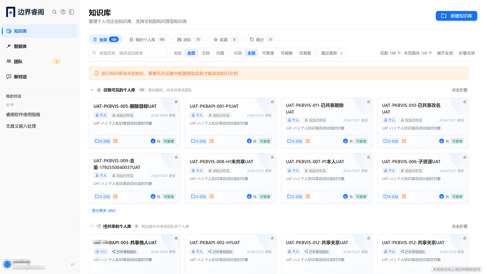
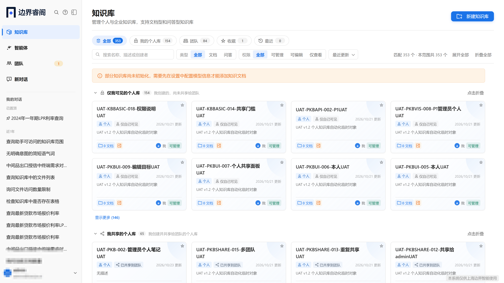
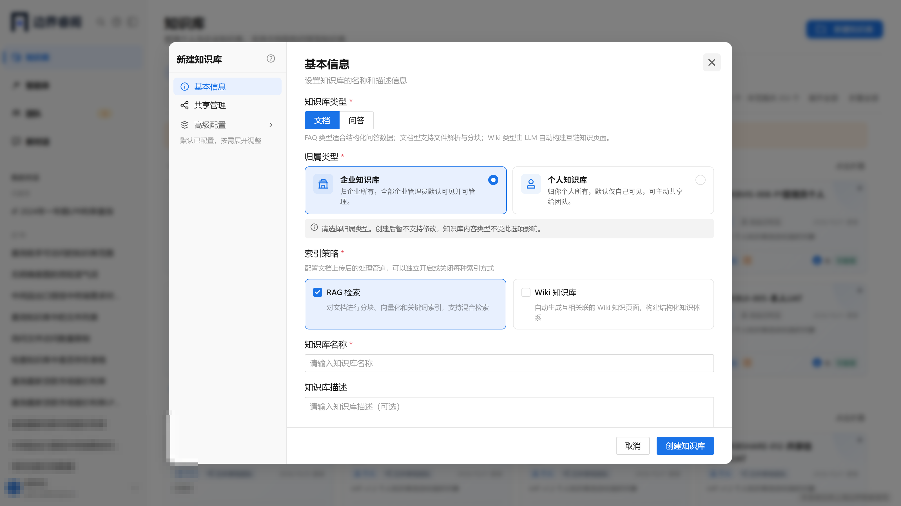
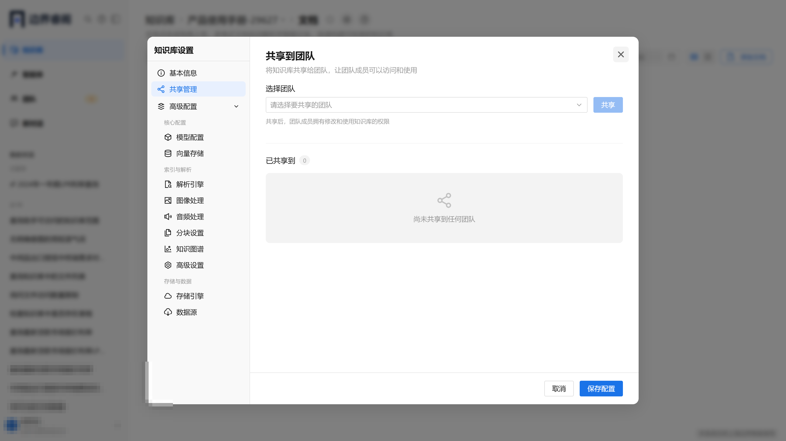
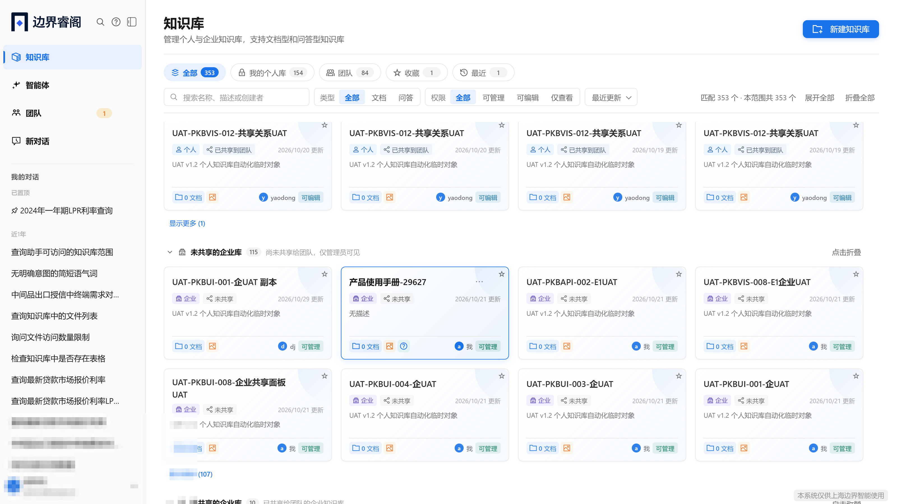

---
title: "知识库管理"
---

## 概述

知识库是睿阁组织文档和知识的核心单元。每个知识库可以独立管理一组文档，支持文档型和 FAQ 问答型两种类型，并可配置不同的索引策略（RAG 检索、Wiki 知识库）。

知识库按归属类型分为**个人知识库**和**企业知识库**，支持共享给团队协作维护。本文介绍如何在知识库列表页完成知识库的浏览、创建、编辑、共享和删除等基础操作。

读完本文你将能够：

- 浏览和筛选知识库列表
- 创建一个新的知识库
- 编辑已有知识库的基本信息
- 将知识库共享给团队并理解共享权限
- 删除不再使用的知识库
- 理解知识库卡片上各标签的含义

---

## 前置条件

- 已登录睿阁，进入主工作区。
- 已完成至少一个模型的配置（创建知识库时需要选择 LLM 和 Embedding 模型），参见系统设置中的模型管理。
- 如需创建知识库，企业创建者、企业管理员和普通成员均可创建（普通成员可创建个人知识库；企业知识库仅企业创建者/企业管理员可创建）。

---

## 操作步骤

### 1. 知识库列表页

> **成员视角**（普通成员）：可见「仅我可见的个人库 / 我共享的 / 共享给我的 / 团队」等，**看不到**未共享的企业库。

点击左侧侧边栏的「知识库」菜单，右侧显示知识库列表页。

#### 顶部区域

- **标题**：「知识库」，副标题为「管理个人与企业知识库，支持文档型和问答型知识库」。
- **新建知识库按钮**：位于标题右侧，点击后打开创建知识库弹窗。企业创建者、企业管理员和普通成员均显示（普通成员可创建个人知识库）。

#### 范围、筛选与排序（v1.2.7+）

| 区域 | 说明 |
| --- | --- |
| 范围标签 | **全部 / 我的个人库 / 团队 / 收藏 / 最近**，显示各范围去重后数量 |
| 搜索 | 对名称、描述、创建者**部分匹配**（英文不区分大小写），可清除 |
| 内容类型 | 全部 / 文档 / 问答 |
| 权限 | 全部 / **可管理**（owner\|admin）/ **可编辑**（editor）/ **仅查看**（viewer），互斥；非法权限值整批报错而非降级为只读 |
| 排序 | 收藏：收藏时间（可选最近更新/名称/内容数量）；最近：访问时间；其他：最近更新/名称/内容数量 |
| 统计 | 「匹配数量 / 当前范围总数」；筛选无结果可「清除筛选」 |

- 搜索与筛选可**叠加**；切换范围后保留搜索词与类型/权限条件。
- 顶部「**重置筛选**」：清空搜索词，类型/权限恢复为全部，不改变范围与排序。
- **我的个人库**仅含本人创建且**尚未共享到团队**的个人库；已共享的在「团队」范围查看。
- **团队**汇总当前用户可见、且直接共享到团队的知识库（不按具体团队再筛）。

#### 分组（全部范围）

| 分组 | 普通成员 | 企业管理员 | 内容 |
| --- | --- | --- | --- |
| 置顶 | ✓ | ✓ | 我置顶的可见知识库 |
| 仅我可见的个人库 | ✓ | ✓ | 本人创建且未共享的个人库 |
| 我共享的个人库 | ✓ | ✓ | 本人创建并已共享给团队的个人库 |
| 共享给我的个人库 | ✓ | ✓ | 他人创建、已共享且我可见的个人库 |
| 未共享的企业库 | — | ✓ | 管理员可见、尚未共享的企业库 |
| 已共享的企业库 | ✓ | ✓ | 已共享的企业库（成员只看自己可见的） |

#### 分组（团队范围）

| 分组 | 内容 |
| --- | --- |
| 置顶 | 我置顶的、团队可见的知识库 |
| 团队共享的企业库 | 已共享给团队的企业知识库 |
| 团队共享的个人库 | 其他成员创建并共享到团队的个人库 |
| 我共享的个人库 | 我创建并共享到团队的个人库 |

要点：

- 分组默认可折叠；支持「**展开全部 / 折叠全部**」；每组默认约两行卡片（4 列 8 个 / 3 列 6 个 / 1–2 列 4 个，最少 4），超出点「**显示更多**」。
- 置顶库在「置顶」组优先展示，同时仍在其原分组出现（代码实现）。
- 卡片显示：类型、创建者、共享状态、当前权限、内容数量、更新时间；混排时可带来源类别（我共享 / 同事 / 管理员）。
- 共享状态文案：个人未共享「**仅自己可见**」、企业未共享「**未共享**」、已共享「**已共享到团队**」（不展示具体团队名）。
- 内容数量：文档库用知识条目数，问答库用分块数；未返回显示「—」。

> 说明：原「全部类型 / 个人知识库 / 企业知识库」归属筛选已由**范围 + 分组**取代。

### 2. 创建知识库

1. 在知识库列表页顶部，点击「新建知识库」按钮。
2. 弹出知识库设置弹窗，首先需要填写**基本信息**（详见 [知识库高级设置](/zh/how-to/02-knowledge-base-settings)）：
   - 选择归属类型（必选项，创建后不可修改）：
     - 企业创建者/企业管理员：两张卡片式单选（单选互斥）——「个人知识库」（归你个人所有，默认仅自己可见，可主动共享给团队）和「企业知识库」（归企业所有，全部企业管理员默认可见并可管理）。
     - 普通成员（member）：不显示归属类型选项，创建的知识库默认为「个人知识库」。
     - 归属类型与知识库类型（文档/问答）相互独立。
   - 选择知识库类型：文档 或 问答。
   - 选择索引策略：RAG 检索 或 Wiki 知识库（仅文档类型）。
   - 填写知识库名称（必填，最多 50 字）。
   - 填写知识库描述（可选，最多 200 字）。
3. 根据需要配置高级选项（模型、分块、解析引擎等），或使用默认配置直接创建。
4. 点击底部「创建」按钮完成创建。

> 提示：创建时系统会自动选择第一个默认模型作为 LLM 和 Embedding 模型，如需调整可在弹窗左侧导航的「高级配置」中修改。

> 注意：归属类型创建后暂不支持修改，知识库内容类型（文档/问答）不受此选项影响。

### 3. 编辑知识库

1. 在知识库列表中，将鼠标悬停到目标知识库卡片上。
2. 点击卡片上的「设置」入口，打开知识库设置弹窗。
3. 在弹窗中修改各项配置，参见 [知识库高级设置](/zh/how-to/02-knowledge-base-settings)。
4. 修改完成后点击底部「保存」按钮。

> 注意：编辑模式下，知识库类型和部分已被文件使用的配置（如 Embedding 模型、索引策略、向量存储引擎）会被锁定不可修改。

### 4. 删除知识库

1. 在知识库设置弹窗中，找到删除入口。
2. 点击删除后，系统弹出二次确认对话框。
3. 确认删除后，知识库及其关联的文件数据将被永久移除。

> 注意：删除操作不可恢复，请谨慎操作。建议在删除前确认知识库中没有重要数据。

### 5. 共享管理

共享管理用于将知识库共享给团队，让团队成员按角色获得对应权限。入口位于知识库设置弹窗左侧导航的「共享管理」菜单（Lite 模式下不显示）。

1. 在「选择团队」下拉框中选择目标团队（下拉项带头像、团队名称、角色、团队成员数、共享数信息），点击「共享」按钮（**创建者或租户 Admin+** 可见）。下拉仅显示**创建者本人**在其中有合适团队角色的团队（owner）或管理员（admin）的团队，且排除已共享的团队。
2. 共享成功后，「已共享到」列表显示已共享的团队信息（带头像、团队名称、角色、团队成员数、共享数），可点击删除按钮取消共享。

#### 共享门槛

**共享与治理**

- **共享到团队**：知识库**创建者**或**租户 Admin+**。
- **他人个人知识库**：管理员可随共享获得查看/库内知识权限，但**不能**改名、改配置、删除或取消共享（后端对治理操作 403）。
- **企业知识库**：创建者或 Admin+ 可共享与治理。
- **可共享到的团队**：你在其中为 **owner/admin** 的团队（editor/viewer 团队不出现在下拉中）。
- **库级治理**（设置/删除/共享变更）不随团队共享授予成员。
- 团队管理员可在「团队设置 → 共享知识库」移除共享到本团队的库。

| 知识库归属 | 谁可以共享 | 限制 |
| --- | --- | --- |
| 个人知识库 | 创建者或租户 Admin+ | 管理员**不能**治理他人个人库（设置/删除/取消共享 403） |
| 企业知识库 | 创建者或租户 Admin+ | 团队侧可在团队设置移除本团队共享 |

#### 共享后权限映射

| 角色/权限 | 说明 |
| --- | --- |
| viewer | 只读 |
| contributor / team admin | 可管理库内知识 |
| 库级治理（设置/删除/再共享） | 不随共享授予：个人知识库仅 owner、企业知识库仅 admin+ |

#### 无权限行为

「共享管理」菜单仅在 Lite 模式下隐藏，与是否为 owner 无关。共享表单（团队下拉框与「共享」按钮）和取消共享按钮仅知识库创建者本人或企业管理员（admin+）可见，其他角色进入后只能查看「已共享到」列表。但对个人知识库，共享关系的新增、删除与变更仅限创建者本人——admin+ 操作他人个人库的共享会被拒绝（接口 403 或 UI 不提供入口）；企业知识库的共享由 admin+ 管理。此外，团队管理员可在团队设置的「共享知识库」页移除共享到本团队的知识库。「设置」「删除」菜单项仅对知识库创建者本人显示（admin+ 亦不得设置、删除他人个人库）。

> 注意：取消共享、成员离开团队或角色降级后，对应权限立即失效。创建模式下的共享操作会暂存，知识库创建成功后批量提交；编辑模式下直接调用接口生效。

> 提示：团队侧可在团队设置的「共享知识库」页查看共享到该团队的知识库，团队管理员可在此移除共享（移除后团队成员将无法再访问该知识库）。

---

## 知识库卡片信息

每个知识库在列表中以卡片形式展示，包含以下信息：

| 信息项 | 说明 |
| --- | --- |
| 名称 | 知识库的名称 |
| 描述 | 知识库的简要描述，无描述时显示"无描述" |
| 归属徽章 | 个人库显示「个人」徽章（用户图标），企业库显示「企业」徽章（建筑图标） |
| 共享状态文案 | 「仅自己可见」（个人库未共享）/「未共享」（企业库未共享）/「已共享到团队」（不显示具体团队名） |
| 来源徽章 | 标识知识库来源：本人创建显示「我创建」，他人创建显示创建者名称（缺失时回退「本企业」），悬浮提示「由 {creator} 创建」。「我的个人知识库」分组内本人创建不显示，「企业知识库」分组不显示，置顶分组与共享分组显示；仅非 Lite 模式显示 |
| 标签 | 根据配置动态显示的功能标签（见下表） |

**功能标签说明**：

| 标签 | 显示条件 | 含义 |
| --- | --- | --- |
| 条目计数徽章 | 始终显示 | 图标 + 数字：文档类型（文件夹图标）显示知识条目数，问答类型（问答图标）显示分块数 |
| 知识图谱 | 启用了知识图谱提取 | 该知识库开启了实体关系提取功能 |
| 多模态 | 启用了多模态功能 | 该知识库支持图片内容解析 |
| 问题生成 | 启用了 AI 问题生成 | 系统会为文档自动生成索引问题 |
| 已共享给 {count} 个团队（图标） | 已共享到其他团队 | 共享图标徽章，悬浮提示「已共享给 {count} 个团队」 |

**收藏星标**：位于卡片右上角，点击切换收藏状态（已收藏为实心星标），与筛选标签中的「收藏」同步。

**更多菜单**：

| 菜单项 | 说明 |
| --- | --- |
| 置顶/取消置顶 | 置顶后进入「置顶」分组展示，**原分组中仍保留**，操作后提示「已置顶/已取消置顶」 |
| 创建副本 | 创建该知识库的副本 |
| 设置 | 打开知识库设置弹窗 |
| 删除 | 删除知识库（需二次确认） |

> 提示：「查看详情」不是更多菜单项，而是共享给我的知识库卡片右上角的详情按钮（信息图标），点击可查看共享详情。

> 注意：个人知识库的非 owner（含企业创建者/企业管理员访问他人个人库）不显示「设置」「删除」菜单项。

---

## 进阶用法

### 收藏知识库

在知识库卡片右上角点击收藏星标，可将常用知识库标记为收藏（已收藏为实心星标）。收藏后可通过筛选标签中的「收藏」快速找到，取消收藏后同步从「收藏」筛选结果中移除。

### 批量管理

当知识库数量较多时，善用顶部**范围**（全部/我的个人库/团队/收藏/最近）与**类型、权限筛选、搜索、排序**快速定位目标知识库。

---

## 常见问题

### Q1：创建知识库时提示模型未配置怎么办？

创建知识库需要至少配置一个 LLM 模型和一个 Embedding 模型。请前往系统设置的模型管理页面添加模型后再创建知识库。

### Q2：知识库类型或归属类型选错了可以修改吗？

知识库类型（文档/问答）和归属类型（个人知识库/企业知识库）在创建后均不可修改。如需更改，请新建一个正确类型的知识库，将原有数据迁移后删除旧知识库。

### Q3：为什么有些配置项在编辑时显示锁定？

编辑模式下，已被文件使用的配置（如 Embedding 模型、索引策略、向量存储引擎）会被锁定，以避免已有索引数据不一致。如需变更这些配置，需要先删除知识库中的文件。

### Q4：删除知识库后文件还能恢复吗？

不能。删除知识库会永久移除其关联的所有文件和索引数据，操作前请确认数据已备份。

### Q5：共享给我的知识库我能编辑吗？

取决于共享到团队时你的团队角色：viewer 只能查看；contributor / team admin 可管理库内知识。但库级治理操作（设置、删除、再共享）不随共享获得——个人知识库仅创建者本人、企业知识库仅企业创建者/企业管理员可操作。

### Q6：为什么智能体检索我的个人知识库时被拒绝（403）？

智能体检索的知识库白名单与当前用户可见集同源。对话中显式指定未授权的个人知识库进行检索时，系统会返回 403 拦截，不降级为全量检索，也不返回任何片段。

---

## 相关文档

- 进阶配置：[知识库高级设置](/zh/how-to/02-knowledge-base-settings)
- 智能体关联：[智能体管理](/zh/how-to/03-agent)

---

> 最后更新：2026-10-28 | 对应版本：v1.8.0
