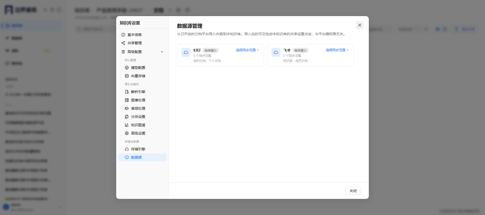
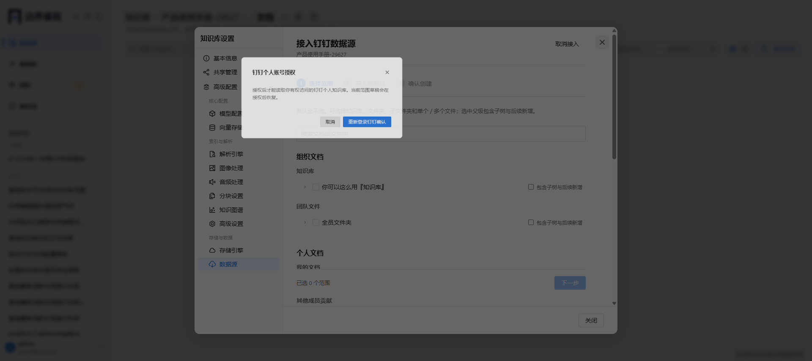
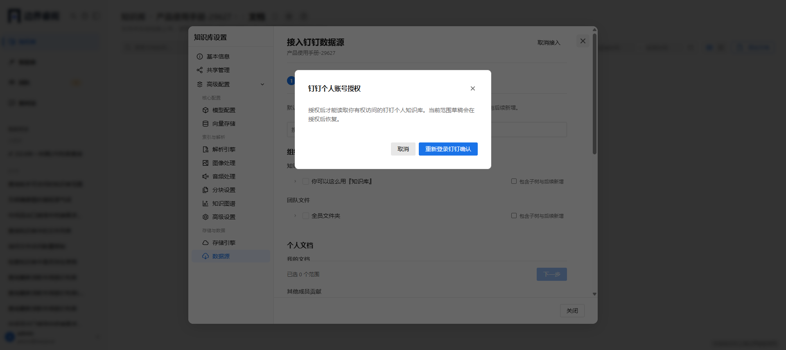
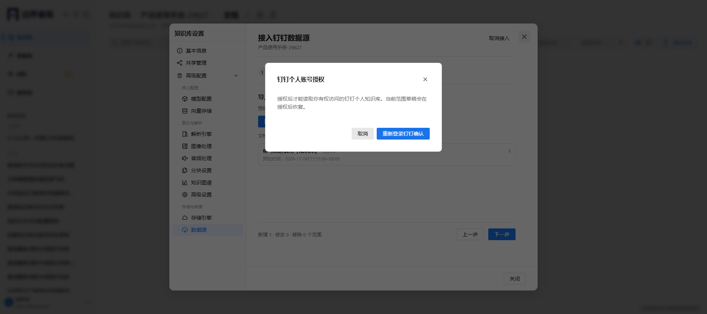
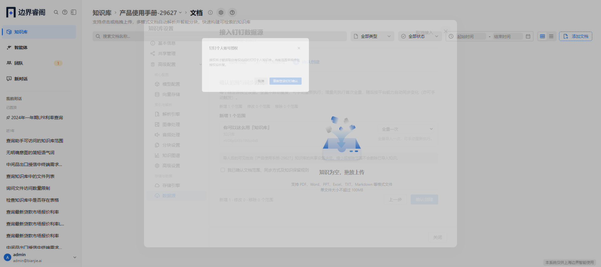

## 概述

边界睿阁支持将钉钉、飞书中的文档**单向导入**到知识库，便于把协作平台里的资料沉淀为可检索、可问答的企业知识。

- **个人知识库**：成员导入本人有权限的文档（钉钉 v1.3 / 飞书 v1.7）
- **企业知识库**：企业管理员导入组织公共文档，并可邀请成员贡献个人文档（钉钉 v1.4 / 飞书 v1.8）

读完本篇后，你将能够配置数据源范围、完成导入前预检、执行首次全量与增量同步，并理解成员贡献文档的生命周期。

> 版本说明：钉钉导入（v1.3.0 / v1.4.0）、飞书导入（v1.7.0 / v1.8.0）；账号授权见 [账号授权](/zh/how-to/09-account-authorization)。

## 前置条件

- 已登录边界睿阁，且目标知识库具备**写入/管理**权限
- 部署侧已配置钉钉或飞书应用凭证（由管理员在服务器配置中提供，界面不管理密钥）
- 个人目标：知识库**写权限** + 已按需完成[账号授权](/zh/how-to/09-account-authorization)。企业**受邀贡献**成员不要求目标库写权限，但**发起邀请的管理员**须有目标库写权限
- 企业目标：具备企业管理员权限；组织公共资产需有已确认平台授权的成员作为读取主体

## 操作步骤

### 1. 打开知识库「数据源」

1. 进入目标知识库 → 右上角「设置」图标 → 展开「高级配置」→「存储与数据」→「**数据源**」（仅编辑模式显示）

2. 选择平台（**钉钉** / **飞书**）。若显示「尚未开放」，表示服务端 platform.available=false（平台未接入），流程入口不可用。

### 2. 选择导入范围

点击平台卡片上的「**选择同步范围**」进入三步向导：**选择范围 → 导入前预检 → 确认创建**。

范围按来源分组（默认全不选）：

| 分组 | 说明 |
| --- | --- |
| 组织文档 | 知识库、团队文件等；选中父级**包含子树与后续新增** |
| 个人文档 | 我的文档（钉钉）/ 我的文档库、云盘（飞书）；需本人账号授权 |
| 其他成员贡献 | 仅展示成员本人确认的范围；可「邀请成员」 |
| 链接添加 | 粘贴钉钉/飞书链接，逐行解析后加入范围 |

| 目标 | 可选范围（示例） | 读取身份 |
| --- | --- | --- |
| 个人知识库 | 钉钉：本人文档、团队知识库/文件（按权限）、支持的链接；飞书：我的文档库、Wiki、云盘（Drive）文件夹、链接；企业场景管理员本人文档/Drive 亦可按贡献规则导入 | 固定为**本人** |
| 企业知识库 | 钉钉：团队知识库、团队文件等组织公共资产；飞书：成员各自可见的 **Wiki 空间并集** | 组织公共资产用**候选成员主体**；成员个人文档由**成员本人**确认贡献 |

要点：

- 支持选择**目录或文件**、设置递归范围，可增删改来源
- 范围选择页**共用一个搜索框**，筛选当前已加载的目录树；清空后恢复原树
- **链接添加**：共享资源可粘贴链接显式导入（需平台侧可读权限）
- 保存前须确认**同步方式**与**目标可见性**；服务端校验身份、权限与范围

**支持类型（按适配器）**：

| 平台 | 支持 | 不支持（示例） |
| --- | --- | --- |
| 钉钉 | 在线文档、表格、可下载白名单文件 | 思维笔记、演示、绘图等 |
| 飞书 | doc / docx / sheet / bitable / file 等 | 以平台权限与实际内容能力为准 |

### 3. 导入前预检

预检是所选范围的**只读扫描**，展示：

- 文档总量、可导入数、支持/不支持计数
- 扫描时间与**不支持名单**

规则：

- **完整扫描**确认「可导入 = 0」时，**阻止**新增或修改来源（以服务端最终规则为准；若界面仍允许提交请以实际版本为准）
- 扫描**不完整**可继续（即使部分结果为 0），界面会明确提示
- 遇传输错误/超时（预检约 30s）必须**重试成功**或**显式跳过**后才能继续；截断结果不写入提交
- 仅移除来源、仅发邀请不受「零可导入」门槛限制

### 4. 确认创建与同步方式

### 4.1 首次全量与增量同步

| 同步方式 | 说明 |
| --- | --- |
| 全量一次 | 创建后可触发首次全量 |
| 持续增量 | 基线建立后默认每 **30 分钟**调度一次（周期由服务端 interval_seconds 下发），也可手动触发；页面「重新同步」为手动全量 |

任务结果提供七类计数（扫描 / 导入 / 更新 / 未变化 / 跳过 / 失败 / 不支持）：**扫描、导入、更新、未变化、跳过、失败、不支持**（扫描数与其他六项对账）。失败项可在允许时通过**新任务**重试。

来源支持：**停用 / 启用 / 删除 / 手动同步**。缩小或移除范围**不会删除**已导入知识；更新以新版本解析成功后的替换为准。

### 5. 企业库：成员文档贡献

1. 管理员在数据源/贡献管理中**邀请**成员贡献其个人文档
2. 成员在邀请中**自行确认**是否贡献及范围
3. 文档贡献邀请默认 **7 天**（仅待处理会过期）；勿与团队邀请链接 1/7/30 天、租户成员邀请 7 天混淆；状态机：待成员授权 → 待成员选择范围 → 已授权 → 已结束（过期/拒绝/取消/撤回等）

| 事件 | 结果 |
| --- | --- |
| 拒绝 / 过期 / 取消 / 管理员结束 | 停止该关系后续读取；**已导入知识保留** |
| 重新完成账号授权 | **不会**自动恢复已结束的文档关系 |

> 账号授权与「知识库文档贡献关系」分开管理：换绑账号授权不影响其他库，也不自动恢复已结束关系。

### 6. 组织公共资产的读取主体（企业库）

- 企业库组织公共资产按**已确认平台授权**的成员可见空间取**并集**，并保留候选主体
- 候选主体全部不可用时会提示管理员处理并暂停读取，避免越权
- 管理员可在候选成员中**切换**实际读取主体

## 常见问题

### Q1：预检显示「不支持」的文档会怎样？

不会导入；名单中列出不支持条目，便于调整范围或先在源端转换格式。

### Q2：导入后源端权限变了，知识库权限会跟着变吗？

不会。数据源是**单向导入**；导入后的可见性以**目标知识库**权限为准。

### Q3：增量多久跑一次？

持续增量默认约 30 分钟一次（依赖调度器与平台可用性），也可手动同步。

### Q4：企业管理员能替成员勾选个人文档吗？

不能。成员个人文档/Drive 属于本人或贡献人范围，须成员本人确认贡献。

## 硬规则（与代码/PRD 对齐）

1. **身份**：全程使用本人/贡献人/候选成员凭证，**禁止应用身份回退**。
2. **预检**：只读扫描；完整扫描可导入=0 时阻止新增/修改来源；扫描不完整可继续并提示。
3. **同步**：默认「全量一次」；增量约 30 分钟（服务端配置）+ 手动全量；同一范围同时仅一个活动任务。
4. **计数**：扫描 / 导入 / 更新 / 未变化 / 跳过 / 失败 / 不支持，扫描数与其余六项对账。
5. **范围**：选父含子树及后续新增；缩小/移除范围、源删除、失权均**保留已导入知识**。
6. **贡献**：邀请提交前为草稿，默认 7 天；待处理可复用；移除最后范围并确认后结束关系。
7. **账号授权 ≠ 文档授权**：结束文档关系不撤销账号授权；重新账号授权不恢复已结束关系。
8. **企业组织资产**：成员可见范围并集 + 候选主体；候选全失效暂停（钉钉提示处理 / 飞书「无法覆盖」）。
9. **类型支持**：钉钉/飞书以适配器白名单为准，预检展示不支持名单。

界面入口：知识库「设置 → 高级配置 → 存储与数据 → 数据源」；平台卡片（钉钉/飞书）上可**添加数据源 / 管理 / 编辑同步范围 / 取消接入**。

## 相关文档

- [账号授权](/zh/how-to/09-account-authorization)
- [知识库高级设置](/zh/how-to/02-knowledge-base-settings)
- [IM 机器人](/zh/how-to/10-im-bot)

> 最后更新：2026-10-28 | 对应版本：v1.8.0
