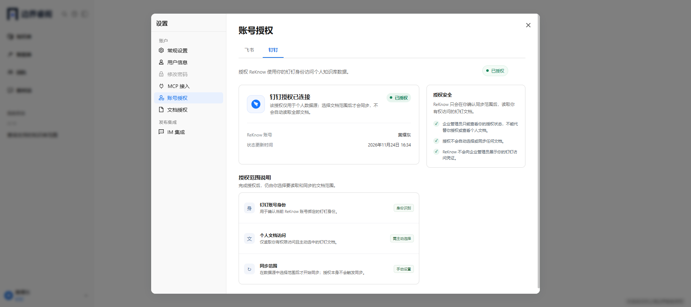
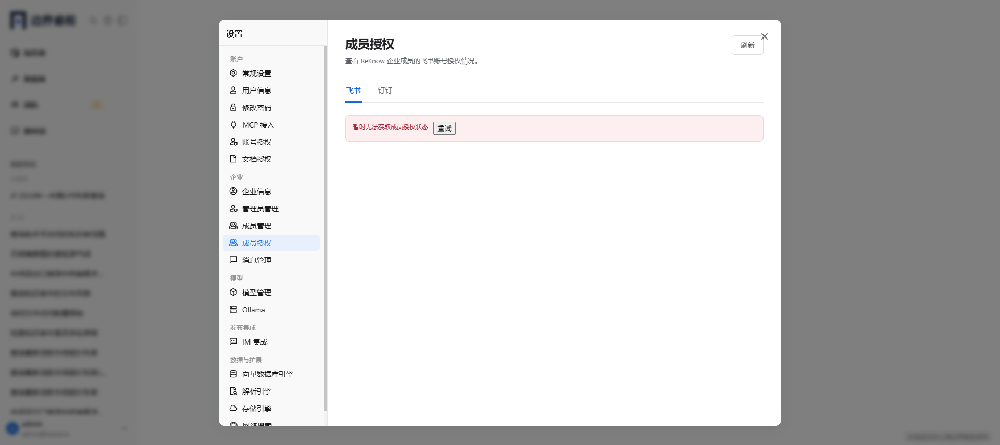
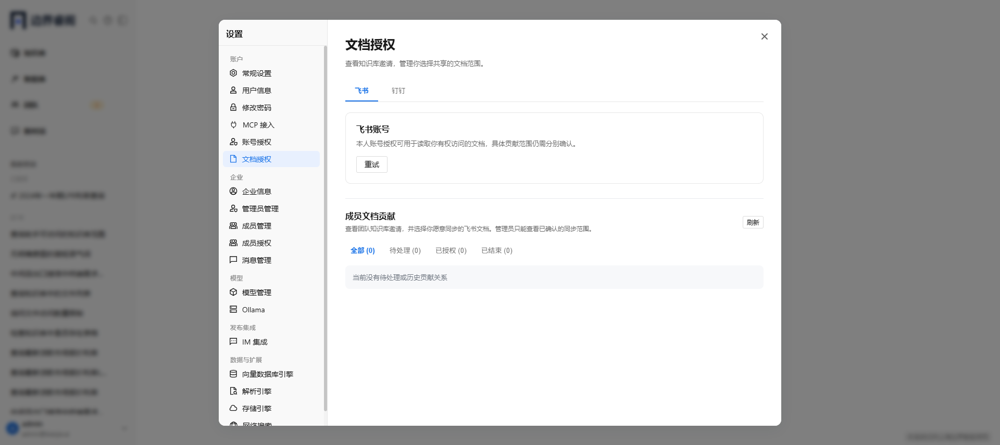

## 概述

在导入钉钉/飞书文档前，成员需要完成**平台账号授权**。边界睿阁将「账号授权」与「某个知识库的文档贡献关系」分开管理，便于安全续期与离职/换绑场景。

读完本篇后，你将了解如何在个人设置中完成飞书/钉钉授权，以及企业管理员如何查看成员授权状态。

> 版本说明：账号级授权与成员授权状态（v1.6.0）；配合文档导入（v1.3–v1.4、v1.7–v1.8）。

## 前置条件

- 已登录边界睿阁（账号密码或 SSO）
- 部署侧已配置对应平台应用

## 能力边界（v1.6）

| 项 | 行为 |
|----|------|
| 入口 | 设置 → 账户 →「**账号授权**」；企业侧「设置 → 空间 → **成员授权**」 |
| 钉钉 | 若以钉钉 SSO 登录，视同完成钉钉身份确认；页面展示已授权/未授权 |
| 飞书 | 需用户凭证；可能因失效/权限范围变化要求**重新授权** |
| 查询失败 | 显示「**暂不可用**」，**不**等于未授权 |
| 与文档关系 | 账号授权**不**创建数据源、**不**选择文档；文档贡献在「**文档授权**」管理 |
| 撤销 | 本期**不提供**成员自主撤销授权入口 |

## 操作步骤

### 1. 个人设置 → 账号授权

1. 打开侧边栏底部用户菜单 →「全部设置」
2. 账户分组下进入「**账号授权**」（路由 `settings?section=feishu-authorization`）

> 图示为钉钉账号**已授权**状态（SSO 登录或 OAuth 同意后）。飞书标签可单独发起授权。

3. 企业管理员可在「企业」分组「**成员授权**」查看成员飞书/钉钉授权状态

4. 「**文档授权**」管理各知识库的文档贡献关系（与账号授权分开）

| 平台 | 行为 |
| --- | --- |
| 飞书 | 保存用户凭证，用于读取云文档；凭证失效或 scope 变更时需**重新授权** |
| 钉钉 | 保存**本人确认**的成员身份；展示已授权/未授权，按主登录方式引导确认或重新登录 |

### 2. 主登录与附加授权

- 使用**同一平台 SSO** 登录成功后，系统会尝试**附加保存**该平台授权
- 附加保存失败**不会**撤销已成功的登录
- 也可先仅完成身份登录，稍后在「账号授权」页补授权

### 3. 跨平台授权

- 可在个人设置中对**另一平台**发起授权（例如飞书登录用户补钉钉授权）
- 钉钉未配置应用时显示「联系管理员」类提示，并保留历史授权关系

### 4. 企业管理员查看成员授权状态

1. 「全部设置」→ 企业分组 →「**成员授权**」
2. 按飞书、钉钉标签查看成员**已授权 / 未授权**（状态查询失败时显示暂不可用，不推断为未授权）

> 管理员**不能代替**成员完成 OAuth；须成员本人操作。

## 说明与边界

- 账号授权**不**自动选择文档、**不**自动创建同步源
- 账号授权与知识库「文档贡献」关系相互独立：结束贡献不撤销账号授权，重新授权也不恢复已结束贡献
- 应用凭证（App ID/Secret）由部署配置提供，界面不管理密钥；界面**不提供**成员自主撤销授权入口（以产品实现为准）

## 常见问题

### Q1：SSO 一登录就算授权了吗？

SSO 保证身份登录；同平台授权会尝试附加保存。若保存失败，登录仍有效，可稍后在「账号授权」补做。

### Q2：飞书显示需要重新授权？

用户凭证或权限范围（scope）可能已失效，重新授权后即可继续导入。

### Q3：钉钉只显示「联系管理员」？

说明当前部署未配置钉钉应用或连接不可用，请联系企业管理员。

### Q4：提示「当前账号无权完成此操作」怎么办？

该提示对应接口 **403**，常见原因是当前账号在企业中的**成员状态不是 active**（例如已被移出企业，数据库 member_status = removed）。此时即使能登录，账号授权等接口也会被拒绝。

处理建议：

1. 企业管理员在「成员管理」中确认该成员状态，必要时重新启用/移回企业
2. 若为测试数据，可将 core.core_users.member_status 恢复为 ctive
3. 与钉钉/飞书授权是否成功无关：授权表里可能已是「已授权」，但状态接口仍会 403

> 产品侧可考虑将文案细化为「账号已停用或已移出企业」，避免与「无授权权限」混淆。

## 相关文档

- [文档导入（钉钉/飞书）](/zh/how-to/08-document-import)
- [访问与登录](/zh/getting-started/01-access-login)
- [全局设置](/zh/reference/04-settings)

> 最后更新：2026-10-28 | 对应版本：v1.8.0
