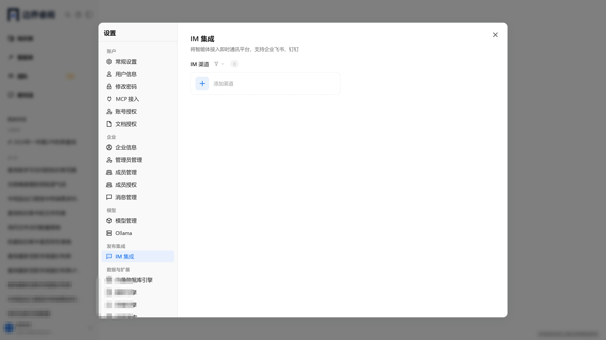
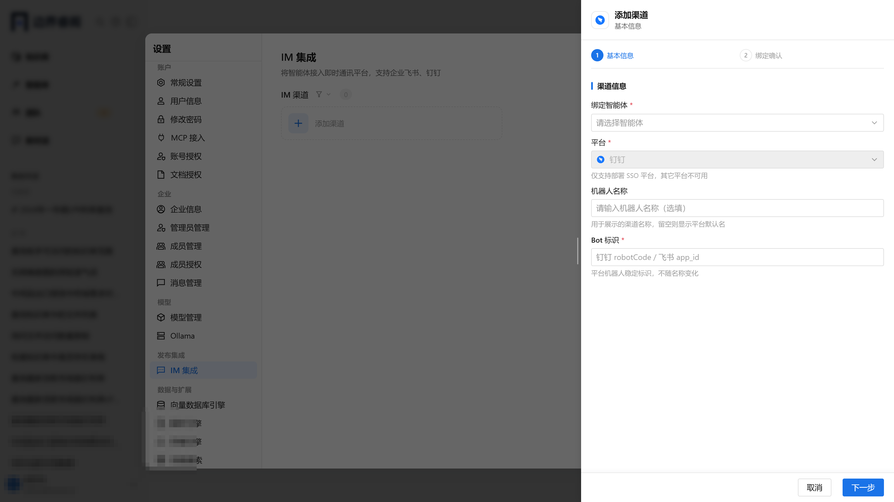
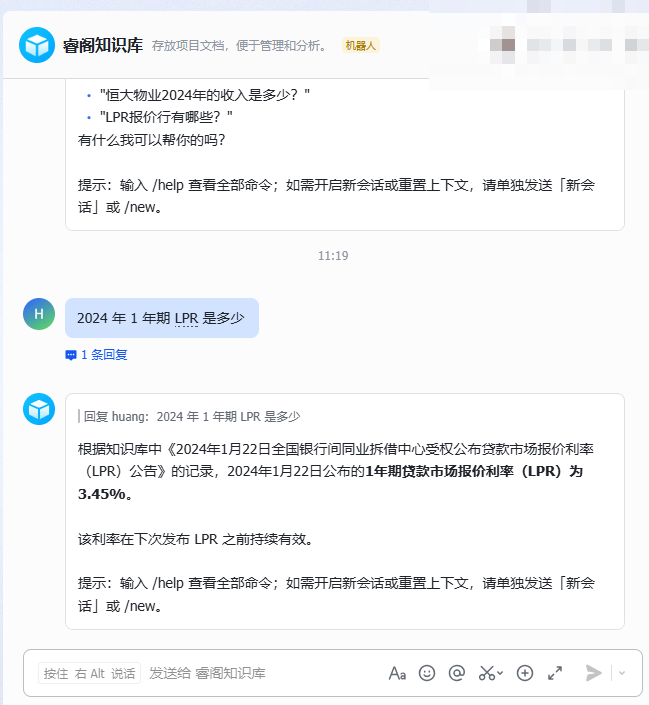
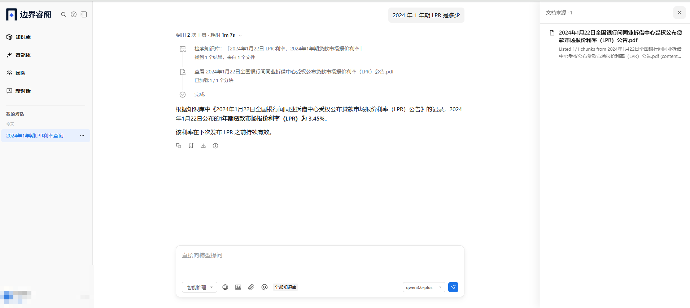

## 概述

边界睿阁支持将智能体接入**钉钉或飞书**，成员在 IM 中**私聊提问**，机器人按该用户在系统内的权限**裁剪检索**后作答，便于在办公软件内直接使用企业知识。

读完本篇后，你将了解 IM Bot 的适用前提、绑定方式与会话规则。

> 版本说明：钉钉与飞书 IM Bot（v1.5.0）。任一部署同时只启用与 SSO 一致的一种 IM 平台。

## 前置条件

- 部署时 SSO 登录方式为**钉钉**或**飞书**（飞连 OIDC / 未配置 SSO 时本功能不可用）
- 已建立「平台用户 → 边界睿阁用户」映射（由管理员同步组织成员产生）
- 部署配置已提供对应 IM 应用凭证（App ID / Secret，由实施人员在服务器配置中提供）
- 已在系统内创建并就绪智能体

## 操作步骤

### 1. 绑定 Bot 与智能体

1. 确认部署 **SSO 为钉钉或飞书**（与 Bot 平台一致）；飞连 OIDC / 未配置 SSO 时**无** IM Bot
2. 企业成员/管理员打开「全部设置」→ 发布集成 →「**IM 集成**」，按向导添加渠道（AppKey/Secret 等，以界面字段为准）
3. **一个 Bot 绑定一个智能体**；启用前用测试成员验证私聊问答
4. 成员在钉钉/飞书中 **私聊** 机器人提问

点击「**添加渠道**」进入两步向导：

5. 确认成员已同步（平台用户→边界睿阁用户映射），并具备智能体所需知识库权限

### 2. 在 IM 中使用

成员在飞书（或钉钉）中私聊机器人提问，回答会引用知识库中的原文出处：

同一问题在 Web 端可查看完整推理过程与**文档来源**：

1. 在钉钉/飞书中找到企业应用机器人
2. **私聊**发送问题
3. 机器人按你的权限检索已授权知识库并回答；需要时查看引用来源（以实际版本为准）

### 3. 会话与权限

| 规则 | 说明 |
| --- | --- |
| 检索裁剪 | 仅检索**该成员有权访问**且**该智能体已配置**知识库的交集内容 |
| 会话归属 | 归属提问成员；Web 端**仅本人可见**（管理员亦不可见他人 IM 会话） |
| 输出/会话模式 | 支持流式/完整输出等渠道配置（以 IM 集成界面为准） |
| 身份校验 | 未映射/非成员消息会被拒绝并引导完成绑定；群聊、外部联系人、匿名不处理 |
| 绑定关系 | 一个 Bot 绑定一个智能体；上线前建议用测试成员验证问答 |
| 幂等与快照 | 重复投递/并发消息按幂等处理，保障答复一致 |

## 说明与边界

- 与 SSO 平台一致：SSO 为钉钉则仅启用钉钉 Bot，SSO 为飞书则仅启用飞书 Bot
- 应用凭证仅存于部署配置，**不**在界面管理、不回显密钥
- 平台侧应用开通与权限申请需在钉钉/飞书管理端人工完成

## 常见问题

### Q1：为什么找不到机器人入口？

请确认部署已配置对应 IM 应用，且 SSO 与 IM 平台一致；联系企业管理员。

### Q2：机器人回答的知识范围是什么？

按**提问用户**在边界睿阁中的知识库权限裁剪，不会越权检索。

### Q3：飞连（OIDC）登录能用 IM Bot 吗？

不能。IM Bot 要求 SSO 为钉钉或飞书，且存在平台用户映射。

## 相关文档

- [访问与登录](/zh/getting-started/01-access-login)
- [智能体管理](/zh/how-to/03-agent)
- [账号授权](/zh/how-to/09-account-authorization)

> 最后更新：2026-10-28 | 对应版本：v1.8.0
